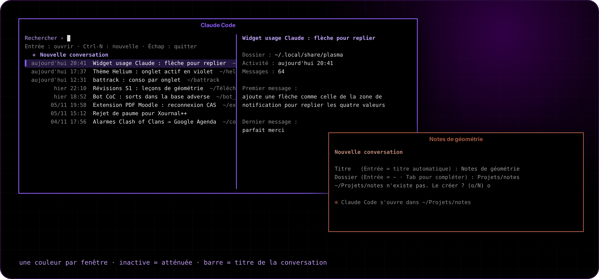

<p align="center"></p>

<p align="center">  </p>

<p align="center"><a href="README.md">🇬🇧 English version</a></p>

**Tape « claude » dans le lanceur d'applications KDE : une fenêtre s'ouvre avec toutes tes conversations Claude Code, les plus récentes en haut. Choisis-en une pour la reprendre, ou tape un titre pour en commencer une nouvelle. Chaque fenêtre a sa propre couleur : impossible de les confondre.**

<p align="center"></p>

## Ce que ça fait

- **Un menu** (fzf) avec toutes les conversations Claude Code de tous les dossiers : titre, date, dossier, et un aperçu avec le premier et le dernier message.
- **Entrée** la reprend dans le bon dossier. **Ctrl-N**, ou une recherche qui ne correspond à rien, en commence une nouvelle : tu donnes un titre, puis un dossier (Tab complète, un dossier qui n'existe pas peut être créé).
- **Une couleur par fenêtre** (8 couleurs : bleu, violet, orange, vert, rose, cyan, jaune, rouge). La barre d'onglet, le cadre de 2 px, le curseur et le thème de Claude Code prennent cette couleur. Les fenêtres inactives sont atténuées. Une 9e fenêtre est refusée avec une notification plutôt que de réutiliser une couleur.
- **La barre affiche le titre de la conversation** et le suit en direct (titre automatique de Claude, ou `/rename`).
- **Ctrl+Z marche** : le lanceur reste derrière Claude et le relance, car il n'y a pas de shell dans la fenêtre pour taper `fg`.

## Installation

Il faut KDE Plasma 6, Konsole, fzf, Python 3 et [Claude Code](https://claude.com/claude-code).

```bash
git clone https://github.com/glime32/claude-launcher-kde && cd claude-launcher-kde && ./install.sh
```

Ensuite, cherche **Claude Code** dans le lanceur d'applications. Les fenêtres n'ont pas de barre de titre KDE : déplace-les avec **Meta + glisser**, redimensionne avec **Meta + clic droit glissé**.

Pour changer les couleurs : `~/.config/claude-window/couleurs` (`nom r,g,b`), puis relance `./install.sh`.

## Comment ça marche

| Fichier | Rôle |
|---|---|
| `bin/claude-window` | Prend la première couleur libre (verrou + fichier pid par couleur dans `$XDG_RUNTIME_DIR`), ouvre Konsole avec la feuille de style Qt et les réglages de cette couleur. |
| `bin/claude-launcher` | Lit `~/.claude/projects/*/*.jsonl`, affiche le menu fzf, puis lance Claude dans son propre groupe de processus, au premier plan du terminal. |
| `tools/generer.py` | Génère pour chaque couleur la feuille de style Konsole, le thème Claude Code (`~/.claude/themes/`) et un `.desktop` pour l'icône de la barre des tâches. |
| `install.sh` | Installe le tout et ajoute une règle KWin par couleur (sans décoration). |

Deux bizarreries de Konsole sont gérées dans `claude-launcher` : fzf tourne dans son propre pseudo-terminal, sans les séquences de « mise à jour synchronisée » (sinon Konsole figeait parfois la fenêtre toute blanche), et c'est le lanceur qui écrit le titre de la fenêtre, pas Claude.

## Désinstaller

```bash
./uninstall.sh
```

Tes conversations ne sont pas touchées.
