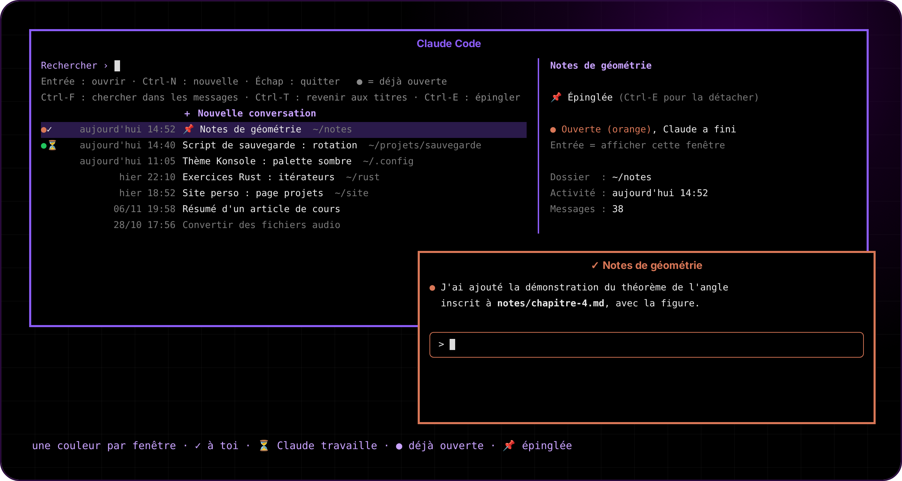

<p align="center"></p>

<p align="center">  </p>

<p align="center"><a href="README.fr.md">🇫🇷 Version française</a></p>

**Type "claude" in the KDE app launcher (or press Meta+C): a window opens with all your Claude Code conversations, most recent first. Pick one to resume it, or type a title to start a new one. Every window gets its own color, so you never mix them up.**

<p align="center"></p>

## The menu

- **Every conversation** from every folder, with title, date, folder and a preview of the first and last message. Conversations older than 7 days are greyed out.
- **Enter** resumes it in the right folder. If it is already open in another window (● in its color), that window is raised instead of opening a second one.
- **Ctrl-N**, or a search that matches nothing, starts a new one: you give a title, then a folder (Tab completes, the last 6 folders are offered by number, a missing folder can be created).
- **Ctrl-F** searches the message text (accent- and case-insensitive), **Ctrl-T** goes back to titles, **Ctrl-E** pins a conversation at the top (📌).
- The menu opens in 2 ms: a per-conversation index lives in `~/.cache/claude-launcher/` and only the new tail of changed files is read.

## The windows

- **One color per window** (8 colors: blue, violet, orange, green, pink, cyan, yellow, red). Tab bar, frame, cursor and the Claude Code theme all use it, and a conversation keeps its color from one session to the next. Inactive windows are dimmed. A 9th window is refused with a notification rather than reusing a color.
- **The tab bar shows the conversation title** and follows it live (Claude's automatic title, or `/rename`), after a state icon: ⏳ Claude is working, ✓ your turn, ❗ Claude waits for your approval.
- **A notification when Claude is done** or needs a permission, only if you aren't already looking at that window; its "Afficher" button brings it back. With the screen locked it also goes to your phone through [ntfy](https://ntfy.sh), if a topic is set in `~/.config/claude-usage/config.json` (shared with [claude-usage-plasma](https://github.com/glime32/claude-usage-plasma), which also shows one dot per open window).
- **One taskbar entry per window** instead of everything grouped under Konsole. Its icon is a rounded tile in the window's color with the Claude Code mascot on it, drawn on whole pixels so it stays sharp at 32 px.
- **Back after a crash or a shutdown**: at the next login, every window that a crash, a logout or a shutdown closed reopens on the same conversation, in the same color, with its last state (Claude doesn't carry on by itself). A window you close yourself, or where you quit Claude, is forgotten.
- **Ctrl+Z works**: the launcher stays behind Claude and resumes it, since there's no shell in the window to type `fg`.

Windows have no KDE title bar: move them with **Meta + drag**, resize with **Meta + right-drag**.

## Install

Needs KDE Plasma 6, Konsole, fzf, Rust (`cargo`) and [Claude Code](https://claude.com/claude-code).

```bash
git clone https://github.com/glime32/claude-launcher-kde && cd claude-launcher-kde && ./install.sh
```

Then search **Claude Code** in the app launcher, or press Meta+C. To change the colors, edit `~/.config/claude-window/couleurs` (`name r,g,b`) and run `./install.sh` again.

## How it works

Everything is Rust (version 0.1 was bash and Python): a small shared library and six binaries installed in `~/.local/bin`.

| Binary | Role |
|---|---|
| `claude-window` | Takes a free color (lock + pid file per color in `$XDG_RUNTIME_DIR/claude-couleurs/`) and opens Konsole with that color's Qt stylesheet and settings. At login, `claude-window --reprise` (from `~/.config/autostart/`) reopens the windows recorded in `~/.local/state/claude-window/fenetres/`. |
| `claude-launcher` | Shows the fzf menu, then runs Claude in its own process group as the terminal's foreground group, and supervises it. |
| `claude-menu` | Keeps the conversation index and feeds the menu its rows, preview and search. |
| `claude-hook` | Claude Code hook (passed through `--settings`, only in these windows): writes the state, keeps a synced copy on disk for the reopening, and sends notifications. It never prints anything, or Claude would add it to the conversation. |
| `claude-focus` | Raises a window by pid (small KWin script). |
| `claude-couleurs` | Generates, for each color, the Konsole stylesheet, the Claude Code theme (`~/.claude/themes/`), the icons, a hidden `.desktop` and a KWin rule without decoration. |

A few KDE quirks handled on the way:

- fzf runs in its own pseudo-terminal with the "synchronized update" sequences stripped: otherwise Konsole sometimes froze the window blank;
- the launcher writes the window title itself, not Claude;
- Plasma 6.8's taskbar files every window whose executable is named `konsole` under Konsole, whatever its app id. So `claude-window` runs a copy of Konsole named `claude-konsole` (in `~/.cache/claude-launcher/`, refreshed when Konsole is updated), and each window gets its own `.desktop` and icon back;
- a window closed by hand and a window closed by a logout both just get SIGHUP. The launcher asks ksmserver (`isShuttingDown`) and systemd (`stopping`) which one it was, and keeps the record only for the second;
- Plasma never closes a notification that went into its history, so `notify-send -w` would wait for hours. The hook gives up after 2 minutes: the notification stays, its "Afficher" button stops working.

## Tests

```bash
cargo build --release && python3 tools/test-reprise.py
```

13 reopening checks (crash, logout, window closed by hand, deleted conversation, window still open…) in a throwaway home, with fake `claude`, KDE and Konsole. A few seconds.

## Uninstall

```bash
./uninstall.sh
```

Your conversations are not touched. The automatic reopening is removed as well.
